УДК 519.87:004.8

# ОБ ИСПОЛЬЗОВАНИИ НЕЙРОННОЙ СЕТИ ДЛЯ УПРАВЛЕНИЯ РАСПРЕДЕЛЕНИЕМ ГРУППЫ БПЛА В ГОРИЗОНТАЛЬНОЙ ПЛОСКОСТИ

**Головкин Пётр Романович**  
ФГБОУ ВО «Ульяновский институт гражданской авиации имени Главного маршала авиации Б. П. Бугаева»

## Аннотация

В работе рассматривается задача верхнеуровневого управления группой мультироторных беспилотных летательных аппаратов по заданному распределению в горизонтальной плоскости. В отличие от подхода, при котором оператор или планировщик задаёт независимую траекторию каждому аппарату, предлагается сначала описывать группу пространственной плотностью ρ(x,y,t), а затем преобразовывать рассчитанное поле движения в индивидуальные команды отдельным БПЛА. Математическая модель основана на уравнении неразрывности и консервативном управляющем потоке. Нейронная сеть типа U-Net используется для аппроксимации поля, получаемого математическим контроллером. Дополнительно разработан дискретный слой, назначающий реальным аппаратам целевые позиции, обеспечивающий обход препятствий, ограничение скорости и ускорения и локальное межбортовое разведение. Практическая постановка намеренно ограничена двумерным случаем: сначала все аппараты набирают заданную рабочую высоту, затем перемещаются в горизонтальной плоскости при постоянной высоте и после завершения распределения получают команду на посадку. Разработано приложение Swarm Density Control GCS, включающее симулятор 1–100 БПЛА и отдельный модуль подключения PX4/ArduPilot-совместимых аппаратов через MAVLink. В базовом вычислительном эксперименте для 10 БПЛА оператор задавал распределение «1 аппарат в область A и 9 аппаратов в область B». Гибридный контроллер обеспечил фактическое распределение 1/9, среднюю ошибку относительно назначенных позиций 1,93 м и минимальную межбортовую дистанцию 2,50 м при среднем времени расчёта шага около 7,2 мс. Результаты показывают возможность использовать плотностное управление как промежуточный уровень между задачей оператора и низкоуровневыми автопилотами отдельных БПЛА.

**Ключевые слова:** БПЛА, рой БПЛА, групповое управление, пространственная плотность, уравнение неразрывности, нейронная сеть, U-Net, MAVLink, PX4, ArduPilot, управление в горизонтальной плоскости.

## Введение

При увеличении количества беспилотных летательных аппаратов усложняется не только расчёт траекторий, но и сам способ постановки задачи оператором. Для одного аппарата естественно указать конкретную точку назначения или последовательность путевых точек. Для группы из десятков аппаратов ручное назначение независимой траектории каждому БПЛА становится неудобным, а для более крупных групп практически теряет смысл. Поэтому в swarm robotics рассматриваются макроскопические модели, в которых группа описывается не полным набором индивидуальных состояний, а распределением или плотностью агентов [1, 2].

В работах по mean-field и density control показано, что управление распределением может формулироваться через дифференциальные уравнения и поля скорости [2, 9]. Для воздушных групп дополнительной задачей является переход от такой абстрактной модели к реальным командам автопилотам. Реальный БПЛА не принимает команду «перейти к плотности ρd»; ему необходимы конкретные управляющие задания — координата, скорость, ускорение или ориентация. Поэтому практическая система должна содержать промежуточный слой, который переводит макроскопическое поле в индивидуальные команды.

В данной работе исследуется именно такая двухуровневая схема. На верхнем уровне состояние группы представляется плотностью ρ(x,y,t), а оператор задаёт целевое распределение. На нижнем уровне текущее положение каждого аппарата сопоставляется с рассчитанным полем и конкретной целевой позицией, после чего формируются индивидуальные команды горизонтальной скорости. Такой подход позволяет сохранить идею управления распределением и одновременно связать математическую модель с реальными автопилотами.

В отличие от полноценной пространственной задачи, в работе рассматривается **движение в горизонтальной плоскости**. Это принципиальное ограничение модели. Предполагается, что все мультироторные БПЛА сначала поднимаются на общую рабочую высоту H, затем выполняют групповое перераспределение по координатам X и Y при z≈H=const и после завершения миссии переходят к посадке. Таким образом, совместный набор высоты, эшелонирование и трёхмерный обход препятствий не входят в рассматриваемую постановку.

### Цель и задачи исследования

**Цель работы** — разработать математическую и программную модель, которая по заданному оператором распределению группы БПЛА в горизонтальной плоскости формирует индивидуальные команды движения отдельным аппаратам и допускает последующее подключение реальных мультироторных БПЛА через MAVLink.

Для достижения цели решались следующие задачи:

1. описать группу БПЛА двумерным полем плотности;
2. сформировать математический эталон управляющего потока на основе закона сохранения количества агентов;
3. использовать нейронную сеть для аппроксимации математического управляющего поля;
4. разработать способ задания оператором произвольного распределения, например «1 БПЛА в одной точке и 9 БПЛА в другой»;
5. преобразовать поле управления в индивидуальные команды каждому аппарату;
6. добавить локальное разведение БПЛА, ограничения скорости и ускорения и обход препятствий на плоскости;
7. реализовать трёхэтапную схему TAKEOFF → PLANAR CONTROL → LAND;
8. создать симулятор для 1–100 аппаратов и модуль подключения реальных БПЛА/SITL через MAVLink;
9. провести вычислительные эксперименты и оценить точность, устойчивость и вычислительное время.

## Методика исследования

На первом этапе была сформирована математическая модель пространственного распределения группы БПЛА в горизонтальной плоскости. Вместо индивидуального описания каждого аппарата состояние системы представлялось полем плотности ρ(x,y,t), показывающим относительную концентрацию аппаратов в различных областях рабочей зоны. Для моделирования задавались начальное расположение группы, целевые области, карта препятствий и общая рабочая высота.

Изменение плотности описывалось уравнением неразрывности. Управляющим воздействием являлось двумерное поле потока. Математический эталон строился по разности текущего и целевого распределений через решение уравнения Пуассона. На синтетических данных математического контроллера была обучена свёрточная нейронная сеть типа U-Net, получающая текущую плотность, целевую плотность и карту препятствий и выдающая два компонента управляющего потока.

На следующем этапе макроскопическая модель была дополнена дискретным слоем для конечной группы 1–100 БПЛА. Оператор задаёт несколько целевых областей и количество аппаратов в каждой из них. Внутри областей автоматически формируются индивидуальные целевые позиции; затем аппараты назначаются на эти позиции с минимизацией суммарного начального расстояния. Для каждого аппарата поле плотностного управления объединяется с движением к назначенной позиции, локальным разведением соседей и обходом препятствий.

В симуляции отдельно моделируются набор рабочей высоты, горизонтальный этап и посадка. Для связи с реальными аппаратами реализован MAVLink-модуль, получающий телеметрию и передающий индивидуальные команды горизонтальной скорости. Экспериментальная оценка выполнялась по средней ошибке до назначенных позиций, MAE распределения, минимальной межбортовой дистанции, времени расчёта одного шага и устойчивости к случайным ошибкам положения.

## 1. Математическое описание группы БПЛА

Пусть Ω⊂R² — ограниченная горизонтальная рабочая область. Состояние группы задаётся функцией

**ρ = ρ(x,y,t),**

где x и y — горизонтальные координаты, t — время. Плотность нормируется условием

**∫Ω ρ(x,y,t)dΩ = 1.**

Такое нормирование позволяет интерпретировать ρ как относительное распределение группы, независимо от конкретного количества аппаратов N.

Перенос плотности описывается уравнением

**∂ρ/∂t + ∇·J = DΔρ,**

где J=(Jx,Jy) — управляющий поток, D — коэффициент диффузии, Δρ — лапласиан плотности. При D=0 получается классическое уравнение неразрывности. Связь потока с полем скорости имеет вид

**J = ρv.**

Физический смысл уравнения состоит в сохранении количества агентов: плотность в некоторой области изменяется только из-за притока, оттока и введённого в модели рассеивания.

### 1.1. Математический эталон

Пусть ρd(x,y) — требуемое распределение. В программе вводится ошибка

**e(x,y)=ρ(x,y)-ρd(x,y).**

Для построения эталонного консервативного поля решается уравнение Пуассона

**Δφ=e,**

после чего управляющий поток принимается равным

**Jb=∇φ.**

Если временно не учитывать препятствия, диффузию и численные ограничения, то

**∇·Jb=Δφ=ρ-ρd.**

Подстановка в уравнение неразрывности приводит к

**∂ρ/∂t=-(ρ-ρd),**

то есть знак поля выбран так, чтобы текущая плотность стремилась к целевой. В реальной численной схеме поток ограничивается по величине, зануляется внутри препятствий и пересчитывается на каждом шаге.

### 1.2. Нейросетевая аппроксимация

Вход нейросети состоит из трёх двумерных каналов:

**X=[ρ, ρd, O],**

где O(x,y) — бинарная карта препятствий. Выход содержит два канала

**NNθ(X)=(Jx, Jy).**

Используемая U-Net обучалась на синтетических состояниях, для которых эталонное поле рассчитывалось математическим контроллером. Таким образом, нейросеть не заменяет физическую постановку задачи, а аппроксимирует отображение «текущее распределение + цель + препятствия → управляющий поток».

Для повышения устойчивости оставлен гибридный режим

**Jh = 0,70JNN + 0,30Jb.**

Экспериментально чистая нейросеть в рассматриваемой версии не превзошла математический эталон; поэтому гибридный режим рассматривается как способ совместить быстроту нейросетевого вывода с сохранением вклада аналитически заданного поля.

## 2. Задание распределения оператором

Для практического применения оператору удобнее задавать не изображение плотности вручную, а набор целевых областей. Каждая цель описывается параметрами

**Gk=(xk, yk, nk, rk),**

где (xk,yk) — центр области, nk — количество БПЛА, которое должно быть направлено в эту область, rk — характерный радиус. Обязательно выполняется

**Σ nk = N.**

Например, при N=10 можно задать:

- область A: nA=1;
- область B: nB=9.

Из этих данных автоматически строится целевая плотность

**ρd(x,y)=1/Z · Σ nk exp(-((x-xk)²+(y-yk)²)/(2σk²)),**

где σk связан с заданным радиусом области, Z — нормирующий коэффициент.

Одновременно внутри целевых областей формируются N дискретных позиций sj. Это необходимо потому, что реальный автопилот управляет конкретным аппаратом, а не непрерывной плотностью.

Для назначения аппаратов на позиции решается задача

**π*=arg minπ Σ ||pi-sπ(i)||,**

где pi — текущая позиция i-го БПЛА. В программной реализации используется алгоритм решения задачи о назначениях [16]. Это позволяет оператору задавать только количество БПЛА в областях, не выбирая вручную, какой именно аппарат должен лететь в каждую точку.

## 3. Преобразование поля в команды отдельным БПЛА

Ключевым практическим дополнением работы является слой **density-to-agent control**. На каждом шаге известны реальные или виртуальные координаты

**pi=(xi,yi).**

В точке положения каждого аппарата интерполируется поле плотностного контроллера. Одновременно учитывается назначенная дискретная цель, соседние аппараты и препятствия. Итоговая горизонтальная команда имеет структуру

**ui = wf uiρ + ws uis + uisep + uiobs,**

где uiρ — вклад плотностного поля, uis — движение к назначенной позиции, uisep — локальное разведение, uiobs — обход препятствий. В поставляемой версии симулятора используются wf=0,35 и ws=0,65. Эти коэффициенты являются параметрами реализации, а не фундаментальными константами модели.

Команда ограничивается условиями

**||ui|| ≤ vmax,**

**||ui(t)-ui(t-Δt)||/Δt ≤ amax.**

Локальный слой безопасности контролирует прогнозируемую дистанцию между парами аппаратов и уменьшает сближающую составляющую скорости при приближении к заданному пределу dmin. Препятствия на рассматриваемой плоскости задаются запрещёнными прямоугольными областями; если прямой участок к назначенной позиции пересекает препятствие, формируется промежуточная путевая точка около свободного угла препятствия.

Такая архитектура принципиально отличается от полного отказа от индивидуального управления. **Оператор не управляет каждым БПЛА отдельно, однако последний уровень системы всё равно формирует отдельную безопасную команду каждому автопилоту.**

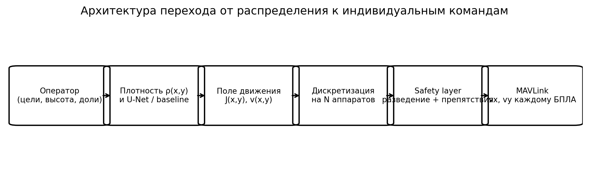

## 4. Управление на плоскости и этапы полёта

В работе не предполагается, что двумерная модель одновременно решает задачу высоты. Полёт разбит на три стадии.

**1. TAKEOFF.** Каждый аппарат получает команду набрать рабочую высоту H. Горизонтальное распределение на этом этапе не выполняется.

**2. PLANAR CONTROL.** После выхода группы на рабочую высоту предполагается

**z1≈z2≈…≈zN≈H=const.**

Далее плотностная модель и дискретный контроллер работают только с x и y.

**3. LANDING.** После достижения распределения горизонтальный контур останавливается, затем аппараты получают команду снижения/посадки.

Такая декомпозиция позволяет корректно связать двумерную математическую модель с реальным полётом, не заявляя решение полноценной трёхмерной задачи.

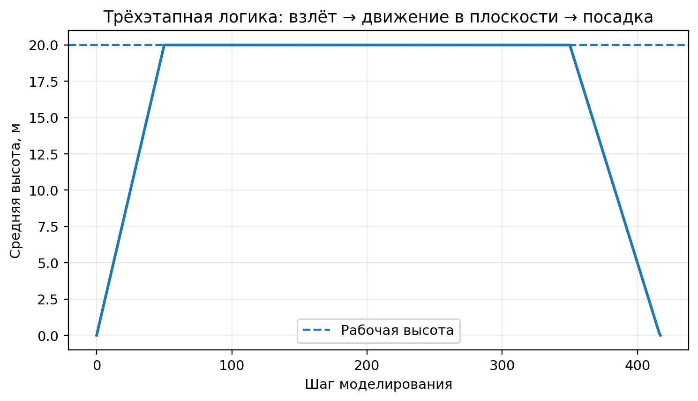

## 5. Схема управления оператором

В предлагаемой архитектуре достаточно одного оператора верхнего уровня. Его задача состоит в формировании миссии, а не в ручном пилотировании каждого аппарата. В интерфейсе задаются:

- количество подключённых БПЛА;
- рабочая высота;
- размеры рабочей области;
- координаты и размеры целевых областей;
- количество БПЛА для каждой области;
- допустимые скорость, ускорение и межбортовая дистанция;
- препятствия и режим контроллера.

После этого система автоматически назначает конкретные аппараты на целевые позиции и рассчитывает их команды.

Для сравнения реализован режим **Leader–Follower**, в котором один аппарат играет роль лидера, а остальные поддерживают заданное положение относительно него. Такой вариант удобен для компактной формации, однако хуже соответствует задаче произвольного перераспределения массы группы между несколькими областями. Поэтому основным методом работы является density control, а leader–follower используется как сравнительный режим.

## 6. Подключение к реальным БПЛА

Разработанное приложение содержит отдельную вкладку **«Реальные БПЛА / SITL»**. Для каждого аппарата задаётся MAVLink endpoint. Программный мост получает heartbeat, глобальные координаты, относительную высоту, скорость и доступную информацию о батарее. Координаты переводятся в общую локальную горизонтальную систему.

Для передачи индивидуального управления используется сообщение MAVLink **SET_POSITION_TARGET_LOCAL_NED**, позволяющее внешнему контроллеру задавать скорости vx, vy, vz в локальной системе NED [13]. Внутри приложения принята визуальная система X=East, Y=North, поэтому перед отправкой выполняется преобразование осей: горизонтальная команда X переводится в компонент East, а Y — в North.

PX4 в режиме Offboard требует непрерывный поток внешних setpoint-сообщений с частотой выше 2 Гц; в реализованном MAVLink-модуле используется фоновая передача с частотой 10 Гц [14]. ArduPilot также допускает работу companion computer через MAVLink, при которой внешний компьютер получает телеметрию и принимает решения верхнего уровня [15].

Для предотвращения случайной отправки команд реальному аппарату введена программная блокировка. Реальный ARM/TAKEOFF и запуск внешнего контура разрешаются только при одновременном выборе режима REAL, подтверждении оператором безопасной зоны и установке системной переменной `SWARM_ENABLE_REAL=1`. По умолчанию приложение допускает безопасную проверку в симуляции и SITL.

Важно отметить, что наличие программного MAVLink-моста не является доказательством готовности к полётной эксплуатации. Перед физическими испытаниями необходимы отдельная верификация failsafe, направления осей, геозоны, радиоканала, GNSS/локальной навигации, параметров конкретного автопилота и возможности ручного перехвата управления.

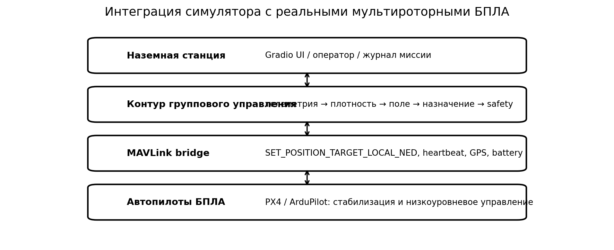

## 7. Вычислительный эксперимент

Базовый эксперимент выполнен для 10 мультироторных БПЛА в прямоугольной рабочей области 80×60 м. Рабочая высота составляла 20 м. Начальное расположение — слева от препятствия. В центре находилась запрещённая область. Оператор задавал две целевые зоны: A для одного аппарата и B для девяти аппаратов. Горизонтальный этап содержал 300 шагов с Δt=0,2 с. Максимальная горизонтальная скорость составляла 4 м/с, максимальное ускорение — 3 м/с², заданная межбортовая дистанция — 2,5 м.

**Таблица 1 — Параметры базового эксперимента**

| Параметр | Значение |
|---|---:|
| Количество БПЛА | 10 |
| Размер рабочей области | 80×60 м |
| Рабочая высота | 20 м |
| Горизонтальных шагов | 300 |
| Шаг времени | 0,2 с |
| Максимальная скорость | 4 м/с |
| Максимальное ускорение | 3 м/с² |
| Заданная минимальная дистанция | 2,5 м |
| Контроллер | гибрид 70/30 |
| Групповой режим | Density control |
| Цель A | 1 БПЛА |
| Цель B | 9 БПЛА |

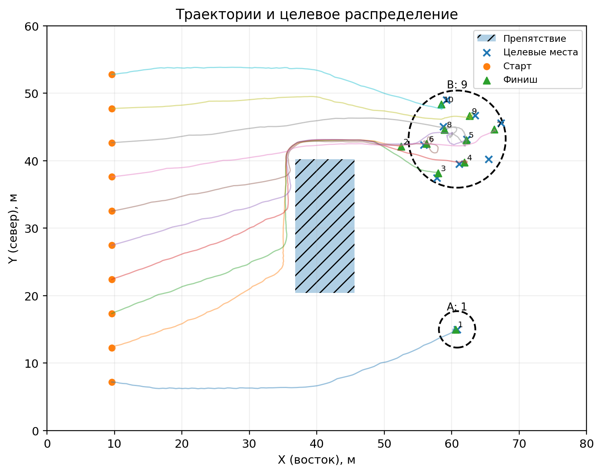

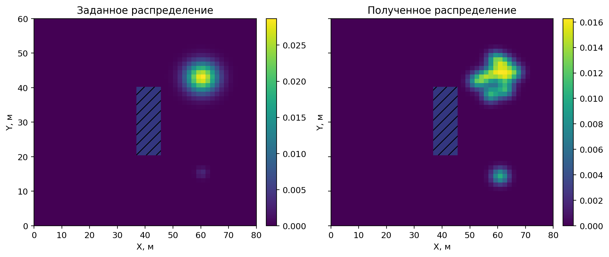

Качество дискретного распределения оценивалось средней ошибкой

**Ep = 1/N Σ ||pi-sπ(i)||.**

Для распределения использовалась также средняя абсолютная ошибка плотности

**MAEρ = 1/M Σ |ρj-ρdj|,**

где M — число ячеек сетки.

Безопасность в симуляции дополнительно характеризовалась величиной

**dmin(t)=min(i≠j)||pi(t)-pj(t)||.**

## 8. Результаты

По завершении базового эксперимента система получила требуемое распределение: в области A находился 1 аппарат, в области B — 9 аппаратов. Средняя ошибка относительно назначенных позиций составила 1,93 м. Девять из десяти аппаратов завершили горизонтальный этап не далее 2 м от назначенной позиции. Минимальная за горизонтальный этап межбортовая дистанция составила 2,5003 м, а на записанных шагах не было зафиксировано пар, находившихся ближе заданного порога 2,5 м. Итоговая MAE плотности составила 2,37·10⁻⁴.

Среднее вычислительное время полного расчёта одного шага для 10 БПЛА составило около 7,2 мс. В эту величину входят построение текущей плотности, получение поля, назначенный дискретный корректирующий слой, обход препятствий и межбортовое разведение.

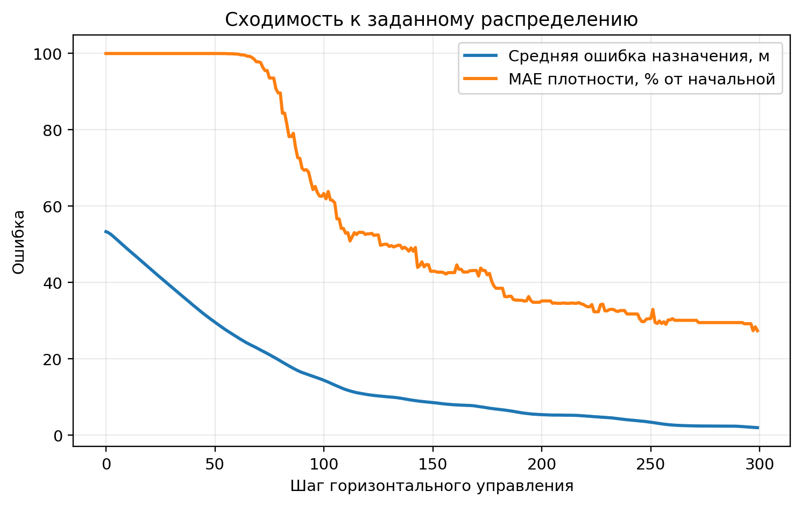

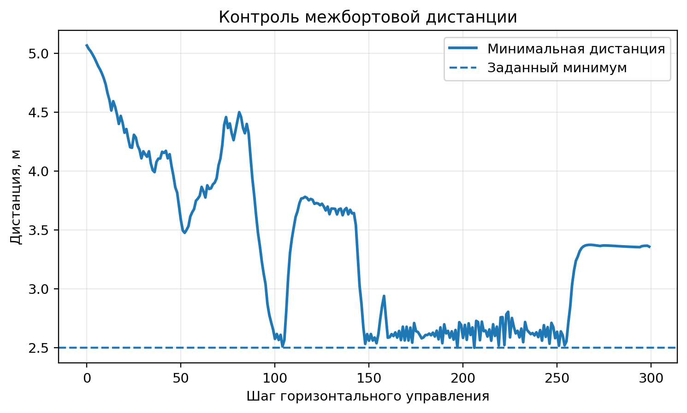

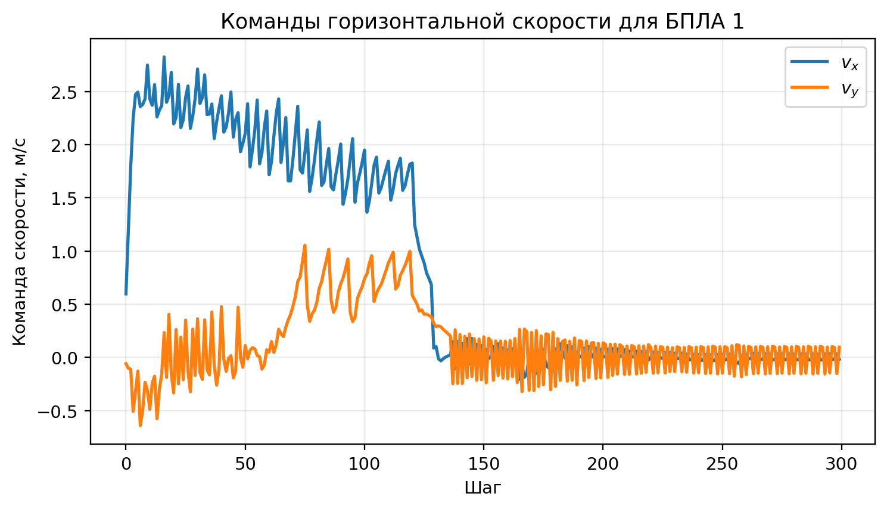

### 8.1. Сравнение способов управления

На одной и той же задаче сравнивались математический эталон, чистая U-Net, гибрид 70/30 и leader–follower.

**Таблица 2 — Сравнение контроллеров**

| Режим | Средняя итоговая ошибка, м | MAE плотности | Минимальная дистанция, м | Среднее время шага, мс |
|---|---:|---:|---:|---:|
| Density: математический эталон | 1,046 | 2,12·10⁻⁴ | 2,501 | 1,68 |
| Density: нейросеть | 4,681 | 3,05·10⁻⁴ | 2,500 | 6,40 |
| Density: гибрид 70/30 | 1,927 | 2,37·10⁻⁴ | 2,500 | 6,27 |
| Leader–Follower | 10,575 | 5,19·10⁻⁴ | 2,017 | 0,55 |

Полученный результат показывает, что на текущем наборе обучения чистая нейросеть не воспроизводит математический контроллер с достаточной точностью, чтобы превзойти эталон. Это важный результат работы: применение нейронной сети само по себе не гарантирует улучшение. Гибридный режим уменьшает ошибку относительно чистой нейросети, однако математический эталон в данном эксперименте остаётся наиболее точным. Следовательно, дальнейшая работа с нейросетевой частью должна быть направлена на расширение обучающей выборки и улучшение функции потерь, а не на утверждение о безусловном преимуществе нейросети.

Leader–follower оказался менее подходящим именно для сценария, где группа должна разделиться между двумя удалёнными областями. Это объясняется тем, что такой режим ориентирован на сохранение относительной структуры вокруг лидера, тогда как density control непосредственно задаёт конечное распределение.

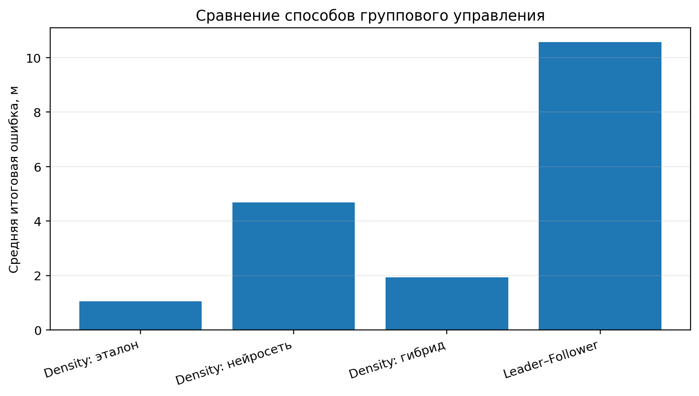

### 8.2. Масштабируемость в диапазоне 1–100 БПЛА

После замечания о необходимости сначала рассматривать небольшие реальные группы масштабируемость оценивалась не для миллионов виртуальных агентов, а для 5, 10, 20, 50 и 100 дискретных БПЛА. Для каждого значения выполнялся короткий одинаковый вычислительный benchmark из 30 горизонтальных шагов. Оценивалось именно время вычисления контроллера; короткий горизонт не предназначен для оценки конечной точности распределения.

**Таблица 3 — Время расчёта одного шага**

| Количество БПЛА | Среднее время шага, мс |
|---:|---:|
| 5 | 6,03 |
| 10 | 6,74 |
| 20 | 7,62 |
| 50 | 8,97 |
| 100 | 14,76 |

Рост времени связан прежде всего с дискретным safety layer, которому необходимо учитывать взаимное положение аппаратов. После векторизации вычислений даже для 100 виртуальных БПЛА среднее время шага в проведённом benchmark осталось менее 15 мс на использованной вычислительной системе. Эти значения характеризуют программный эксперимент и не включают задержки радиоканала, автопилота и реальной телеметрии.

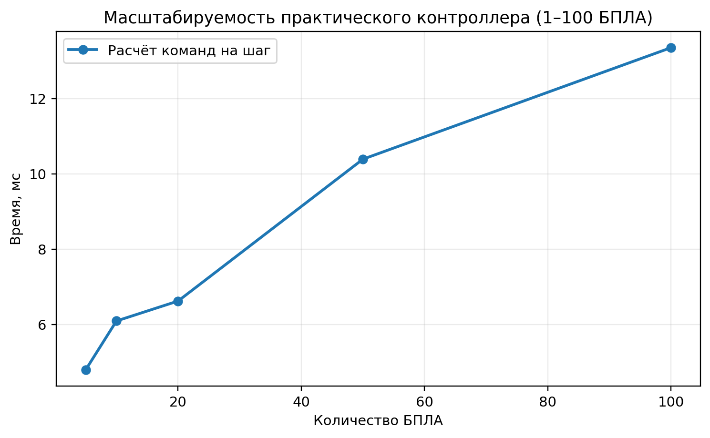

### 8.3. Возмущения положения

Для проверки устойчивости в координаты аппаратов после каждого шага добавлялась случайная ошибка с заданным стандартным отклонением. При σ=0,05 м итоговая ошибка назначения составила 1,78 м, при σ=0,12 м — 1,90 м. Эти значения близки к результату без шума 1,93 м; небольшая немонотонность связана с конкретной фиксированной реализацией случайного процесса. При увеличении σ до 0,25 м ошибка выросла до 9,93 м, а минимальная межбортовая дистанция снизилась до 1,56 м. Следовательно, простой локальный safety layer устойчив к малым отклонениям, но не обеспечивает гарантированную безопасность при крупных возмущениях.

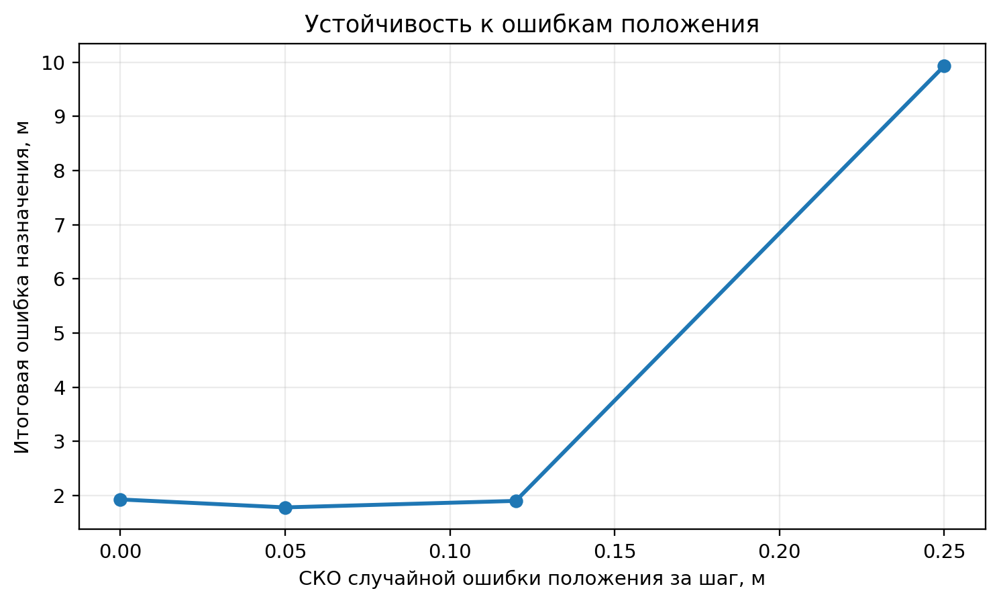

## 9. Обсуждение и ограничения

Проведённая работа позволяет связать континуальную модель с конкретной схемой управления отдельными БПЛА, однако полученный прототип имеет несколько существенных ограничений.

Во-первых, исследуется двумерная постановка. Препятствие считается запрещённой областью на всей рабочей высоте, хотя в реальной трёхмерной среде его можно было бы облететь сверху или снизу. Для перехода к 3D необходимо заменить ρ(x,y,t) на ρ(x,y,z,t), а двумерное поле — на трёхкомпонентное.

Во-вторых, практический модуль ориентирован на мультироторные аппараты. Квадрокоптер способен зависнуть и непосредственно выполнять команды горизонтальной скорости. Для БПЛА самолётного типа требуется учитывать минимальную скорость, курс, радиус разворота, ограничения угла крена и невозможность остановки в точке. Поэтому непосредственное применение разработанного нижнего слоя к самолётному БПЛА некорректно без отдельной динамической модели.

В-третьих, препятствия в текущем симуляторе имеют простую геометрию. Для реального применения необходима работа с геозонами, картой местности и динамическими препятствиями.

В-четвёртых, локальное межбортовое разведение является эвристическим защитным слоем, а не формально доказанным collision-avoidance алгоритмом. Эксперимент с сильным шумом показывает, что при больших ошибках заданная дистанция может нарушаться. Для физического роя требуется более строгий метод, например control barrier functions, ORCA-подобное взаимное уклонение или модельно-предиктивный safety layer.

В-пятых, реальный MAVLink-модуль разработан и программно связан с контроллером, но результаты статьи получены в симуляции. Полётные испытания на реальной группе в данную работу не включены. Следующим этапом должна быть последовательность: single-UAV SITL → multi-UAV SITL → стенд без винтов → ограниченная группа 2–3 аппаратов → постепенное увеличение N.

## Заключение

В работе разработана система, связывающая математическое управление распределением с индивидуальными командами конечной группе мультироторных БПЛА. Оператор задаёт не траекторию каждому аппарату, а требуемое распределение группы: количество аппаратов в целевых областях, их координаты и характерный радиус. На верхнем уровне текущее состояние представляется полем плотности и рассчитывается управляющий поток. На нижнем уровне аппараты назначаются на конкретные позиции, после чего для каждого формируется собственная команда скорости с учётом препятствий и соседей.

Важным уточнением постановки является работа именно в горизонтальной плоскости. Набор высоты и посадка отделены от основного этапа управления, поэтому математическая модель не претендует на полноценное трёхмерное управление.

Для базового сценария из 10 БПЛА с заданием 1/9 система получила требуемое количественное распределение, среднюю ошибку 1,93 м и минимальную дистанцию 2,50 м. Сравнение показало, что математический эталон в текущей версии точнее чистой нейросети, а гибридный вариант существенно уменьшает ошибку нейросетевого режима. Это показывает необходимость дальнейшего обучения U-Net и одновременно подтверждает полезность математического эталона как контролируемого базового метода.

Разработанный Swarm Density Control GCS объединяет симулятор 1–100 БПЛА, генерацию индивидуальных команд и отдельную вкладку подключения PX4/ArduPilot-совместимых аппаратов через MAVLink. Таким образом, результат работы представляет собой не только модель распределения, но и программный каркас для последующего перехода от вычислительного эксперимента к SITL и физической группе мультироторных БПЛА.

## Список литературы

1. Lerman K., Martinoli A., Galstyan A. A Review of Probabilistic Macroscopic Models for Swarm Robotic Systems // Swarm Robotics. Lecture Notes in Computer Science. 2005. Vol. 3342. P. 143–152. DOI: 10.1007/978-3-540-30552-1_12.
2. Elamvazhuthi K., Berman S. Mean-field models in swarm robotics: a survey // Bioinspiration & Biomimetics. 2020. Vol. 15, No. 1. 015001. DOI: 10.1088/1748-3190/ab49a4.
3. Bullo F., Cortés J., Martínez S. Distributed Control of Robotic Networks: A Mathematical Approach to Motion Coordination Algorithms. Princeton University Press, 2009.
4. Mesbahi M., Egerstedt M. Graph Theoretic Methods in Multiagent Networks. Princeton University Press, 2010.
5. Olfati-Saber R., Fax J. A., Murray R. M. Consensus and Cooperation in Networked Multi-Agent Systems // Proceedings of the IEEE. 2007. Vol. 95, No. 1. P. 215–233. DOI: 10.1109/JPROC.2006.887293.
6. LeVeque R. J. Finite Volume Methods for Hyperbolic Problems. Cambridge University Press, 2002.
7. Evans L. C. Partial Differential Equations. 2nd ed. American Mathematical Society, 2010.
8. Raissi M., Perdikaris P., Karniadakis G. E. Physics-informed neural networks: A deep learning framework for solving forward and inverse problems involving nonlinear partial differential equations // Journal of Computational Physics. 2019. Vol. 378. P. 686–707. DOI: 10.1016/j.jcp.2018.10.045.
9. Sinigaglia C., Manzoni A., Braghin F., Berman S. Robust optimal density control of robotic swarms // Automatica. 2025. Vol. 176. Article 112218. DOI: 10.1016/j.automatica.2025.112218.
10. Soria E., Schiano F., Floreano D. Predictive control of aerial swarms in cluttered environments // Nature Machine Intelligence. 2021. Vol. 3. P. 545–554. DOI: 10.1038/s42256-021-00341-y.
11. Rubenstein M., Cornejo A., Nagpal R. Programmable self-assembly in a thousand-robot swarm // Science. 2014. Vol. 345, No. 6198. P. 795–799. DOI: 10.1126/science.1254295.
12. Yang L., Jiang J., Gao X., Wang Q., Dou Q., Zhang L. Autonomous environment-adaptive microrobot swarm navigation enabled by deep learning-based real-time distribution planning // Nature Machine Intelligence. 2022. Vol. 4. P. 480–493. DOI: 10.1038/s42256-022-00482-8.
13. MAVLink. Common Message Set: SET_POSITION_TARGET_LOCAL_NED. URL: https://mavlink.io/en/messages/common.html (дата обращения: 23.09.2026).
14. PX4 Autopilot. Offboard Mode / MAVROS Offboard control. URL: https://docs.px4.io/ (дата обращения: 23.09.2026).
15. ArduPilot Development Team. Companion Computers. URL: https://ardupilot.org/dev/docs/companion-computers.html (дата обращения: 23.09.2026).
16. Kuhn H. W. The Hungarian method for the assignment problem // Naval Research Logistics Quarterly. 1955. Vol. 2, No. 1–2. P. 83–97. DOI: 10.1002/nav.3800020109.
